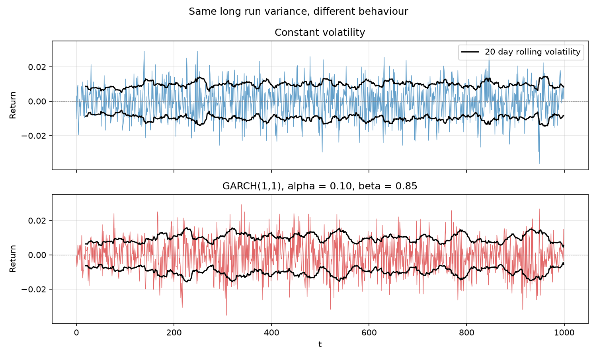
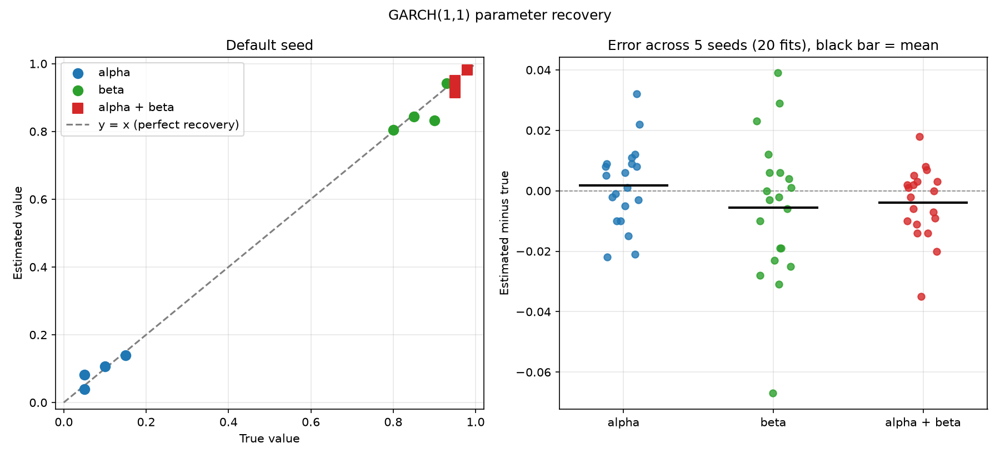
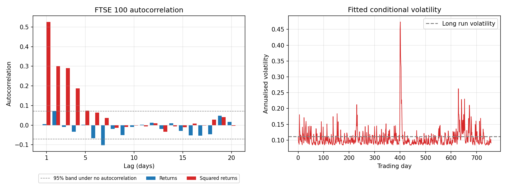

# GARCH-lite: Volatility Clustering in Simulated and Real Returns

## 1. Motivation

The AR(1) project found that the direction of FTSE 100 daily returns is close to unpredictable. The lag 1 autocorrelation of returns is 0.0058. That does not make the size of returns unpredictable. Large moves tend to follow large moves and small moves tend to follow small ones. This is called volatility clustering [1]. It breaks the constant volatility assumption used in the Brownian motion and Black-Scholes projects.

GARCH(1,1) is the standard model for it [2]. This project implements it from scratch in C++: a simulator, a maximum likelihood estimator and a variance forecast. It follows the same plan as the earlier projects. The estimator is first tested on synthetic data with known parameters and then applied to real FTSE 100 log returns.

This project tests four hypotheses. First, FTSE returns are uncorrelated but squared returns are correlated. Second, the estimator recovers the persistence of a synthetic GARCH series to within 0.05. Third, the FTSE persistence is high, since long samples of equity indices are usually reported to have persistence close to 1 [3]. Fourth, GARCH forecasts beat a constant variance forecast out of sample.

## 2. Mathematical Background

**Definition 2.1 (GARCH(1,1) process).** A return series $\varepsilon_t$ follows a GARCH(1,1) process if

$$\varepsilon_t = \sqrt{h_t}\, z_t, \qquad z_t \sim N(0,1) \text{ independent},$$

$$h_t = \omega + \alpha\, \varepsilon_{t-1}^2 + \beta\, h_{t-1},$$

with $\omega > 0$, $\alpha > 0$ and $\beta \ge 0$. Here $h_t$ is the variance of $\varepsilon_t$ given everything up to time $t-1$ [2].

**Definition 2.2 (Persistence and unconditional variance).** The persistence of the process is $p = \alpha + \beta$. If $p < 1$ the process is stationary and has long run variance [2]

$$V = \frac{\omega}{1 - \alpha - \beta}.$$

**Remark 1.** The direction of $\varepsilon_t$ is unpredictable, since $z_t$ has mean zero and is independent of the past. The size of $\varepsilon_t$ is not, since $h_t$ depends on recent shocks. So the autocorrelation of $\varepsilon_t$ is zero while the autocorrelation of $\varepsilon_t^2$ is positive and decays geometrically at rate $p$. This is why volatility clustering shows up in squared returns and not in returns.

**Definition 2.3 (Half life of a variance shock).** The gap between the variance and its long run level shrinks by a factor $p$ each day. The half life is the number of days for it to halve:

$$t_{1/2} = \frac{\ln 0.5}{\ln p}.$$

**Definition 2.4 (Variance forecast).** Given the one step ahead variance $h_{T+1}$, the forecast $k$ days ahead is

$$E[h_{T+k}] = V + p^{k-1}\,(h_{T+1} - V),$$

which decays from the current variance back to $V$.

**Definition 2.5 (Gaussian quasi-likelihood).** For shocks $\varepsilon_1, \dots, \varepsilon_n$ and variances $h_1, \dots, h_n$ the log likelihood under normal shocks is

$$\ell(\alpha, \beta) = -\frac{1}{2} \sum_{t=1}^{n} \left( \ln 2\pi + \ln h_t + \frac{\varepsilon_t^2}{h_t} \right).$$

It is called a quasi-likelihood because it is used as an objective even though real returns are not exactly normal [4].

**Definition 2.6 (Variance targeting).** Setting $\omega = v\,(1 - \alpha - \beta)$, where $v$ is the sample variance, makes the long run variance equal to the sample variance [5]. This leaves two free parameters, $\alpha$ and $\beta$.

**Definition 2.7 (QLIKE loss).** For realised shocks $\varepsilon_t$ and forecast variances $h_t$,

$$\text{QLIKE} = \frac{1}{n} \sum_{t=1}^{n} \left( \ln h_t + \frac{\varepsilon_t^2}{h_t} \right).$$

Lower is better [6].

**Remark 2.** The variance of a day is never observed. The squared return is a noisy stand-in for it. QLIKE is used alongside the mean squared error of squared returns because it is less distorted by a few extreme days [6].

## 3. Method

All logic is in `garch.h`. It reuses `readClosingPrices` and `computeLogReturns` from the AR(1) project.

**Part A: Validation on synthetic data.** Series of 5000 observations are simulated from four settings of $(\alpha, \beta)$: $(0.05, 0.90)$, $(0.10, 0.85)$, $(0.15, 0.80)$ and $(0.05, 0.93)$. The long run variance is $10^{-4}$, which is a daily volatility of 1 percent. Each series starts at its long run variance. The estimator is run on each series and compared with the truth. The whole experiment is repeated for five seeds: 1, 2, 3, 42 and 100. That gives 20 fits.

**Part B: Real FTSE 100 returns.** The 759 closing prices in `data/ftse100.csv` give 758 log returns. The program computes the autocorrelation of returns and squared returns for lags 1 to 20 and then fits GARCH(1,1). It reports the half life and the long run, current and one year average forecast volatility, all annualised by multiplying by $\sqrt{252}$.

**Part C: Out of sample check.** The model is fitted on the first 530 returns (70 percent). The remaining 228 returns are the test set. The fitted parameters are held fixed and the variance recursion is run through the test period, so each test day gets a one step ahead variance. The benchmark is a constant variance equal to the training sample variance. Both are scored with QLIKE and with the mean squared error of squared returns.

**Estimation.** The estimator maximises the quasi-likelihood over $(\alpha, \beta)$ with variance targeting. A coarse grid search covers $\alpha$ from 0.01 to 0.30 and $\beta$ from 0.00 to 0.99 in steps of 0.01. A fine grid then searches within 0.015 of the best point in steps of 0.001. Points with $\alpha + \beta \ge 0.999$ are skipped to keep the model stationary. A grid search needs no starting guess and no optimiser. It is slower than a gradient method but it is simple and cannot diverge.

**Remark 3.** An earlier version searched $\beta$ only from 0.50. The FTSE fit returned $\beta = 0.485$, which was the lower edge of the fine grid, so the search had stopped because it ran out of grid. Widening the coarse range to start at 0 moved the estimate to $\beta = 0.361$, which is inside the grid. The synthetic results did not change.

## 4. Results

### 4.1 Synthetic data



*Figure 1. A constant volatility series and a GARCH(1,1) series with the same long run variance. The black lines are a 20 day rolling volatility. The GARCH band moves between about 0.005 and 0.015 while the constant band stays near 0.01. A 20 day window is noisy even for constant volatility, so the difference is visible but modest.*

Across the 20 fits the errors were as follows. They are computed from values printed to three decimal places.

| Quantity | Mean absolute error | Largest absolute error | Mean signed error |
|---|---|---|---|
| $\alpha$ | 0.011 | 0.032 | +0.002 |
| $\beta$ | 0.018 | 0.067 | −0.006 |
| $\alpha + \beta$ | 0.009 | 0.035 | −0.004 |

All 20 persistence errors are below 0.05, so the second hypothesis holds. Persistence is recovered about as well as $\alpha$ and about twice as well as $\beta$. The mean signed errors are small, so there is no large systematic bias.

The errors in $\alpha$ and $\beta$ tend to have opposite signs within the same fit. For true $(0.05, 0.90)$ and seed 42 the estimate was $(0.082, 0.833)$, an error of $+0.032$ in $\alpha$ and $-0.067$ in $\beta$ that mostly cancel in the sum. This is consistent with a likelihood that is nearly flat along a line of constant persistence, so the two parameters trade off against each other.



*Figure 2. Left: true against estimated values for the default seed. Right: estimated minus true for all 20 fits, with the mean as a black bar.*

### 4.2 FTSE 100

The lag 1 autocorrelation of returns is 0.0058, which matches the AR(1) coefficient of 0.00575 from the earlier project. The lag 1 autocorrelation of squared returns is 0.524. At lags 2 to 4 it is about 0.30, 0.29 and 0.19. It falls to the edge of the 95 percent band of $\pm 0.071$ by about lag 5. So the first hypothesis holds.

| Quantity | Value |
|---|---|
| $\hat{\alpha}$ | 0.284 |
| $\hat{\beta}$ | 0.361 |
| Persistence | 0.645 |
| Half life of a variance shock | 1.58 days |
| Long run volatility (annualised) | 11.2% |
| Current volatility (annualised) | 8.6% |
| Average forecast over the next year (annualised) | 11.1% |

The third hypothesis did not hold. A persistence of 0.645 is below the values near 1 usually reported for long samples. The data suggest why. Five of the eight largest daily moves in the sample fall in the five trading days from 4 to 10 April 2025: −4.95%, −4.38%, +2.71%, −2.92% and +3.04%. The fitted volatility peaks at about 0.47 annualised there and is back to normal within days. A short burst of large shocks that settles quickly is what a model with a large $\alpha$ and a small $\beta$ describes. The fit was not repeated without that week, since removing the largest days to improve the result would defeat the purpose. This explanation is an inference from the data and has not been tested.



*Figure 3. Left: autocorrelation of returns and squared returns with the 95 percent band under no autocorrelation. Right: fitted annualised conditional volatility with the long run level dashed.*

### 4.3 Out of sample

| Measure | GARCH | Constant variance |
|---|---|---|
| QLIKE | −8.910 | −8.828 |
| MSE of squared returns | $9.94 \times 10^{-9}$ | $1.005 \times 10^{-8}$ |

GARCH has the lower QLIKE by 0.082. The mean squared error is about 1 percent lower, which is practically a tie. So the fourth hypothesis holds on QLIKE and not on the mean squared error. This is one split with 228 test days and no significance test, so it is weak evidence.

## 5. Verification

`test_garch.cpp` has five Catch2 test cases with 807 assertions in total.

1. A simulated path has the requested length and every variance is positive.
2. Two simulations with the same seed give the same returns.
3. For $\alpha = 0.05$, $\beta = 0.90$ and 200000 observations the sample variance is within 10 percent of the long run variance $\omega / (1 - \alpha - \beta)$.
4. For $\alpha = 0.10$, $\beta = 0.85$ and 100000 observations the lag 1 autocorrelation of returns is below 0.02 in size and the lag 1 autocorrelation of squared returns is above 0.10.
5. For 10000 observations the fitted persistence is within 0.05 of the true value and the fitted likelihood beats a constant variance model on the same data.

The seed sweep in Part A is a second check that the recovery is not an accident of one random draw. The FTSE results in Part B use real data and no random numbers, so they are the same for every seed.

## 6. Limitations

- **Data.** The FTSE 100 file is one index in one currency over about three years, 758 returns. The estimates describe this window and not the long run behaviour of the index. The fit is dominated by one week in April 2025.
- **Identification.** Even with 5000 simulated observations $\alpha$ and $\beta$ are recovered less well than their sum. The real series is much shorter. No standard errors or confidence intervals are reported.
- **Normal shocks.** The objective assumes normal shocks. Daily index returns usually have heavier tails [1], so the fitted parameters are those that best fit a normal model.
- **Symmetry.** A fall and a rise of the same size have the same effect on the next variance. The model cannot capture a larger response to bad news [1].
- **Constant mean.** The mean return is the sample mean and is not modelled.
- **Search.** The grid has a resolution of 0.001 and the coarse grid stops at $\alpha = 0.30$. The FTSE estimate of 0.284 is inside it.
- **Out of sample test.** One 70/30 split, 228 test days, one step ahead variances and no refitting. There is no significance test.
- **Validation.** The synthetic data come from the same model the estimator assumes, so this is the easiest case. Four parameter settings and five seeds is a small experiment.
- **Compiler.** The synthetic results were produced with MSVC and differ in the last digits on GCC. The FTSE results are identical on both.

## 7. Reproducing this Project

Build with CMake. Set `EIGEN_INCLUDE_DIR` if Eigen is not found.

```
cmake -S . -B build -DEIGEN_INCLUDE_DIR=<path to Eigen>
cmake --build build --config Debug
```

Run the program. The seed is optional and defaults to 42. It reads `../data/ftse100.csv` and writes `garch_validation.csv`, `garch_acf_ftse.csv`, `garch_ftse_result.csv`, `garch_ftse_sigma.csv` and `garch_oos_result.csv`.

```
build/Debug/garch.exe 42
```

On Linux the executable is `./build/garch`.

Run the tests.

```
build/Debug/garch_tests.exe
```

Make the figures. They need numpy, pandas and matplotlib.

```
python plot_garch_paths.py
python plot_garch_validation.py
python plot_garch_ftse.py
```

Run the seed sweep. It saves `garch_validation_seed<seed>.csv` for each seed, which `plot_garch_validation.py` reads for the right hand panel. Run `garch.exe` again afterwards to restore the default seed 42 files.

```
bash run_garch_simulations.sh
```

Load the results into PostgreSQL. The connection string is read from the `PG_CONN_STRING` environment variable and is never stored in the repository. The three tables are `garch_validation_results`, `garch_ftse_results` and `garch_oos_results`. Their definitions are in `.github/workflows/build.yml`.

```
python load_results.py
python query_results.py
```

GitHub Actions runs the same steps against a PostgreSQL service container on every push.

## 8. Future Work

The main weakness is the short sample. The natural next step is to fit the model on a much longer FTSE 100 history and to add bootstrap confidence intervals for $\alpha$ and $\beta$, so the instability seen in the validation can be measured on real data. An asymmetric variance equation would then test whether bad news raises volatility more than good news.

## 9. References

[1] R. Cont, "Empirical Properties of Asset Returns: Stylized Facts and Statistical Issues", *Quantitative Finance*, 1(2), 223 to 236, 2001.

[2] T. Bollerslev, "Generalized Autoregressive Conditional Heteroskedasticity", *Journal of Econometrics*, 31(3), 307 to 327, 1986.

[3] R. F. Engle and T. Bollerslev, "Modelling the Persistence of Conditional Variances", *Econometric Reviews*, 5(1), 1 to 50, 1986.

[4] T. Bollerslev and J. M. Wooldridge, "Quasi-Maximum Likelihood Estimation and Inference in Dynamic Models with Time-Varying Covariances", *Econometric Reviews*, 11(2), 143 to 172, 1992.

[5] C. Francq, L. Horváth and J.-M. Zakoïan, "Merits and Drawbacks of Variance Targeting in GARCH Models", *Journal of Financial Econometrics*, 9(4), 619 to 656, 2011.

[6] A. J. Patton, "Volatility Forecast Comparison Using Imperfect Volatility Proxies", *Journal of Econometrics*, 160(1), 246 to 256, 2011.
